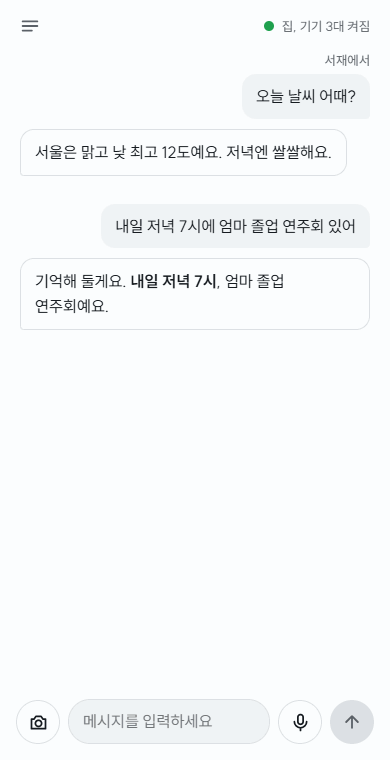

<p align="center">
  
</p>

# Kkachi

Kkachi (까치, "magpie") is an agent that stays home. It runs on the computer you already have, and you call it from your phone, at home or away, to see what is happening there and get things done. It remembers what you tell it in your own Markdown notes, and the old phones in your drawer become its eyes, ears and voice in each room.

It started from not wanting to set up Home Assistant OS just to try a home assistant: a dedicated machine or a VM, an OS image, and add-ons before anything answers. Kkachi is one command on a computer that stays on, and one web page on each phone.

<p align="center">
  
</p>

The agent behind it is [Pi](https://github.com/earendil-works/pi), a coding agent, run with a setup of Kkachi's own: you sign it in to a model subscription you have (Claude or ChatGPT) or an API key, and add the MCP tools it may use, all in Kkachi Home. So besides the home it can search the web, use those tools and work on code.

> [!NOTE]
> Early prototype. Runs on macOS, Windows, and Linux (the Linux auto-start is untested). The apps' interface is in Korean.

> [!WARNING]
> Kkachi runs Pi with full access to your computer (shell, files, network) and acts without asking. Anyone who can reach it can make it run commands by voice. Expose it only through Tailscale Serve on a tailnet you control, never Tailscale Funnel or a public URL.

## Why Kkachi

Home Assistant is a hub: it joins devices to each other and runs automations, and it is the right tool for a house full of them. Kkachi is an agent: you ask, and it looks, answers and acts. It works with no smart device at all, and it leaves wiring devices together to the hub: when you have lights or cameras, Home Assistant plugs into Kkachi as one more MCP server ([docs/ha.md](docs/ha.md)), and Kkachi uses it when you ask.

Two rules decide what goes in ([docs/philosophy.md](docs/philosophy.md), Korean):

1. **Light.** One install, no VM, no hub: the computer you have and the phones you no longer use. A spare phone joins by opening a web page, with nothing to install on it. Heavier things, like Home Assistant or local models, are added when you want them.
2. **Yours.** Your memory is plain Markdown in your own git repo: every turn is a commit, and "forget that" reverts it. What devices see and hear is passed on and not stored. Apart from the LLM, Kkachi calls no outside service unless you choose one, and speech can run on your computer too.

Not there yet: dictation uses Groq by default (running it locally is a setting, and wants a small GPU), and the install command pulls in Git, Bun, Pi and Tailscale, so "one command" is still a few minutes and four tools.


One process, kkachi-core, runs the agent and starts two services that are plain MCP servers. Anything else that speaks MCP is added in Kkachi Home's settings (도구), and other agents (Claude Desktop, Codex) can use Kkachi's devices and memory the same way. The detailed diagram is [docs/architecture.svg](docs/architecture.svg).

## Installation

You need a computer that stays on (macOS, Windows, or Linux), a phone, a model account to sign in to (Claude Pro/Max, ChatGPT Plus/Pro, or an API key), and a [Tailscale](https://tailscale.com/download) account on both the computer and the phone.

On the computer, macOS or Linux:

```sh
curl -fsSL https://raw.githubusercontent.com/junyeong-nero/kkachi/main/install.sh | sh
```

Windows:

```powershell
powershell -c "irm https://raw.githubusercontent.com/junyeong-nero/kkachi/main/install.ps1 | iex"
```

It installs what is missing ([Git](https://git-scm.com/downloads), [Bun](https://bun.sh), [Pi](https://pi.dev), Tailscale), puts Kkachi in `~/kkachi`, asks a few questions, starts Kkachi now and at every login, and prints an address like `https://<computer>.<tailnet>.ts.net`. That one install is all three parts below.

### Kkachi Home

The app on your phone: where you talk to Kkachi and look after the devices.

1. Install Tailscale on the phone and sign in to the same account as the computer.
2. Open the address the setup printed.
3. Add the page to your home screen.
4. In its menu, open 설정, then 계정, and sign in to Claude or ChatGPT (or enter an API key).

### Kkachi Device

A spare phone or tablet becomes a Kkachi Device: Kkachi's eyes, ears and voice in that room. It has a speaker, a microphone, a camera, a sound meter, motion sensors, and on a tablet a lamp.

1. Open `/device` at the same address on the spare phone, name it ("living room") and tap once.
2. Allow it in Kkachi Home's menu, under 기기. 기기 추가 in the same menu shows these steps with the address to copy.
3. Keep its screen on.

Then "tell the living room dinner is ready" plays there, "how is the living room?" gets a photo and an answer, and holding the talk pad on its screen asks Kkachi something from that room. In Kkachi Home's menu, open a device to see what is happening there now (how loud it is, when it last moved, a photo when you ask) and to choose what Kkachi may use there.

Real lights, plugs and speakers come in through MCP servers, added in Kkachi Home under 설정, 도구: Home Assistant for a whole house (and the Hue, Tapo, IKEA, Matter or SmartThings devices joined to it) and LG ThinQ are suggested there, asking only for an address or a token; any other server is added by its address or command ([docs/extensions.md](docs/extensions.md) lists some, Korean). Kkachi switches them when you ask.

### Kkachi Memory

Your notes: a git repo of Markdown files that the setup creates on your computer (or an existing one you point it to). Kkachi writes to it as you talk and answers from it. It stays on your computer; to back it up, add a remote and set `KKACHI_MEMORY_SYNC=1` ([docs/setup.md](docs/setup.md#memory-repo)).

## Documents

Most are in Korean.

| Doc | What is in it |
|---|---|
| [docs/setup.md](docs/setup.md) | Updating, installing by hand, voices, running as a service, everyday use, other agents, the memory repo (English) |
| [docs/philosophy.md](docs/philosophy.md) | The two rules and where Kkachi does not meet them yet |
| [docs/design.md](docs/design.md) | How Kkachi Home and the device page behave, the voice pipeline, local speech |
| [docs/bus.md](docs/bus.md) | How devices talk to Kkachi, what is open to Kkachi, and the device conversation settings |
| [docs/sensors.md](docs/sensors.md) | What a spare phone can do, feature by feature |
| [docs/ha.md](docs/ha.md) | Setting up Home Assistant with ha-mcp |
| [docs/extensions.md](docs/extensions.md) | MCP servers worth adding |
| [docs/modules.md](docs/modules.md) | What each module does and how a turn flows through them |
| [DESIGN.md](DESIGN.md) | The visual system (English) |

## License

[MIT](LICENSE). The two services carry the same license in their folders.
