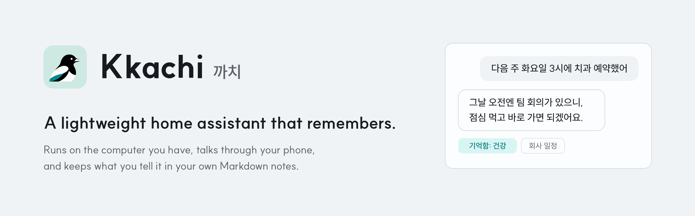
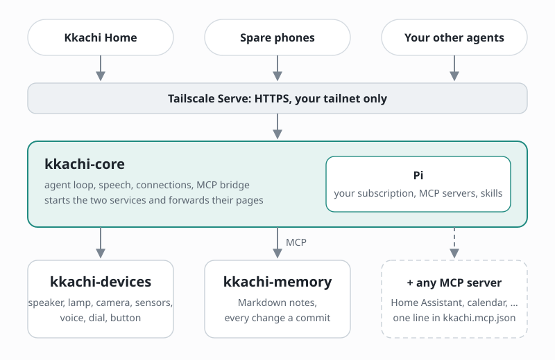

# Kkachi (까치)

Kkachi is a lightweight home assistant that remembers. It runs on the computer you already have, and you talk to it from your phone. What you tell it goes into your own Markdown notes (a git repo). The old phones in your drawer become its speakers, microphones and cameras by opening a web page.

The agent behind it is [Pi](https://github.com/earendil-works/pi), the coding agent, running with your subscription, your MCP servers and your skills, so it can also search the web, use your tools and work on code.

On your phone you type or dictate (check the transcript, then send). Replies come back as text and can be read aloud.

> [!NOTE]
> Early prototype. Runs on macOS, Windows, and Linux (the Linux auto-start is untested).

> [!WARNING]
> Kkachi runs Pi with full access to your computer (shell, files, network) and acts without asking. Anyone who can reach it can make it run commands by voice. Expose it only through Tailscale Serve on a tailnet you control, never Tailscale Funnel or a public URL.

## What you need

- A computer that stays on (macOS, Windows, or Linux). Kkachi runs there.
- A phone. You use Kkachi in its browser.
- An account Pi can sign in to for a model, such as Claude Pro/Max or ChatGPT Plus/Pro.
- A [Tailscale](https://tailscale.com/download) account, used on both the computer and the phone.

## Install

### 1. On the computer

macOS or Linux:

```sh
curl -fsSL https://raw.githubusercontent.com/junyeong-nero/kkachi/main/install.sh | sh
```

Windows:

```powershell
powershell -c "irm https://raw.githubusercontent.com/junyeong-nero/kkachi/main/install.ps1 | iex"
```

The command installs what is missing ([Git](https://git-scm.com/downloads), [Bun](https://bun.sh), [Pi](https://pi.dev), [Tailscale](https://tailscale.com/download)), puts Kkachi in `~/kkachi` and runs its setup. The setup asks a few questions and then:

- creates your memory repo, or uses an existing one
- signs Pi in to a model provider if it is not yet, and lets you pick a model
- offers to bring in the MCP servers you set up for Claude Code, Codex, Cursor or VS Code (through [pi-mcp-adapter](https://github.com/nicobailon/pi-mcp-adapter))
- asks for a Groq API key for dictation, which you can skip
- saves settings to `.env.local`
- starts Kkachi now and at every login
- makes it reachable on your tailnet with Tailscale Serve, signing this computer in to Tailscale first if needed

At the end it prints an address like `https://<computer>.<tailnet>.ts.net`.

### 2. On your phone

1. Install Tailscale and sign in to the same account as the computer.
2. Open the address the setup printed.
3. Add the page to your home screen.

Add `?debug` to the URL for an on-screen log.

### Update

Run the install command again. It skips anything already installed and updates Kkachi.

### Install by hand

Install [Git](https://git-scm.com/downloads), [Bun](https://bun.sh), [Pi](https://pi.dev) and [Tailscale](https://tailscale.com/download) yourself, then run the same setup:

```sh
git clone https://github.com/junyeong-nero/kkachi.git
cd kkachi
bun run init
```

`init` checks the tools before it starts. You can run it again later; it keeps what is already set up. To sign Pi in yourself first, use `pi auth login`.

## Voice (optional)

Typing needs nothing extra. Dictation and neural voices are optional.

To dictate, get a free [Groq API key](https://console.groq.com/keys) for speech-to-text. The setup asks for it, or add `GROQ_API_KEY` to `.env.local` later. Groq is an outside service and the next piece to move local (see [Principles](#principles)). Cleaning up transcripts with an LLM (English terms, noise) is off unless you set `KKACHI_POLISH_MODEL`, for example `openai/gpt-oss-120b` on the same key. Speech-to-text can also run on your computer with whisper.cpp, at about ten seconds a sentence on a laptop CPU ([docs/design.md](docs/design.md), Korean).

Hearing replies needs nothing extra: each phone and spare device reads them in its own built-in voice. For Microsoft's neural voices instead (generated online), install [uv](https://docs.astral.sh/uv/), run `uv tool install edge-tts`, and pick one of the voices in Settings.

## Run and configure

Kkachi runs as a background server:

```sh
bun run service status      # or: install, uninstall
```

Its log is `data/service.log`. To run in the foreground instead, use `bun start`.

| OS | How it runs |
|---|---|
| macOS | A launchd agent that runs while you are logged in. |
| Linux | A systemd user service. `sudo loginctl enable-linger $USER` keeps it running while you are logged out. |
| Windows | Starts when you sign in (from the Startup folder, so no admin rights are needed) and stops when you sign out. Sleep stops it too, so keep the computer awake. |

All settings are environment variables in `.env.local` (see `src/config.ts`), for example `KKACHI_MODEL` for the model and fallbacks, `KKACHI_PORT`, `KKACHI_TIMEZONE`, and OpenAI-compatible speech APIs instead of Groq and Edge TTS. Kkachi works with any model your Pi can use and falls back to the next one in `KKACHI_MODEL` when one is rate-limited.

## What it does

### Talk and remember

- Type, or tap the mic and dictate into the text box to check before sending. Read-aloud is off by default and set per device.
- There are no commands to learn. Saying "thanks, that's all" or "I'll take it from the computer" ends the conversation, and the librarian then tidies the notes.
- Mention a plan or decision and it goes into the right note, without Kkachi announcing "I've noted that". Each turn is one git commit, and "forget that" reverts it.
- Ask about your own life and it answers from the notes, showing which notes it used.
- Take or pick up to four photos and ask about them. They go to the model only; the memory repo records only that there were photos.
- It can search the web, use MCP tools, and work on code in other repos: whatever your Pi setup can do.

### Spare phones and tablets

1. Open `/device` on a spare phone or tablet, name it ("거실") and tap once.
2. Allow it in Settings → 기기 in the phone app.
3. Keep its screen on.

After that:

- "거실에서 밥 먹으라고 말해줘" plays on it.
- From the phone app Kkachi can take a photo there ("거실 지금 어때?"), measure how loud it is, read its motion and orientation sensors, and turn its screen into a lamp. Nothing is stored ([docs/sensors.md](docs/sensors.md)).
- Each input and output has an on/off switch on the device's own screen.
- Hold the device's button to ask Kkachi something. The device sends what you said and moves on; Kkachi answers there, on your phone, or both.

By default a device joins your phone's conversation with the same tools, which assumes only you use these devices. Settings → 공기계 대화 can give devices a conversation of their own, limit them to the notes, speaking and the lamp, and keep private details from being said aloud ([docs/bus.md](docs/bus.md)). Your own MCP servers stay with the phone app unless you let devices use them too.

### Other agents

Claude Desktop, Codex, another Pi, or anything else that speaks MCP can use your devices and your memory. Add one of these to its MCP config:

| Address | Tools |
|---|---|
| `https://<computer>.<tailnet>.ts.net/mcp/devices` | `list_devices`, `device_speak`, `device_snapshot`, `device_sound_level`, `device_sensors`, `device_light` |
| `https://<computer>.<tailnet>.ts.net/mcp/memory` | `memory_list`, `memory_search`, `memory_read`, `memory_write`, `memory_edit`, `memory_move`, `memory_delete`, `memory_undo` |

Each memory change is one `kkachi: …` commit (pushed only if sync is on) and can be undone.

### Lights, speakers and Home Assistant

When you get real lights, speakers or cameras, plug in Home Assistant with [ha-mcp](https://github.com/homeassistant-ai/ha-mcp). Kkachi then switches lights, plays music on your speakers and sets up automations ("turn the living room light off at 11 every night"). Put the ha-mcp address in `.env.local` as `KKACHI_HA_MCP_URL`; setup steps are in [docs/ha.md](docs/ha.md) (Korean). Without that setting, nothing Home Assistant-related runs.

To control lights without Home Assistant, see [docs/extensions.md](docs/extensions.md) (Korean), which lists MCP servers worth adding, local ones first.

### In the background

After 30 quiet minutes, Kkachi checks the conversation against the notes for anything it missed, such as a decision or an appointment. New information is committed as `kkachi: 대화 정리 — …` (and pushed if sync is on, see [Memory repo](#memory-repo)); if there is nothing to add, there is no commit. Turns waiting for this review stay in the server's private `data/conversation.jsonl` (not the memory repo) until it succeeds, across restarts too. Your chat session is not reset.

A librarian then sorts the changed notes and rewrites the catalog in the memory repo's `README.md`. A new message always goes ahead of this background work.

## Memory repo

Your notes live in a separate git repo that you own, created from `templates/memory/`. Its `AGENTS.md` tells Kkachi how to organize notes. Do not store secrets (ID numbers, bank accounts, passwords) in it.

### Backup

The notes stay on your computer: Kkachi never pushes or pulls unless you ask it to. To keep a backup:

1. Add a remote: a private GitHub repo, or a bare repo on a USB drive or NAS (`git init --bare E:/kkachi-memory.git`).
2. Push yourself now and then, or set `KKACHI_MEMORY_SYNC=1` in `.env.local` to have Kkachi pull before each turn and push after each commit.

A remote on its own changes nothing.

### Import existing notes

If you already keep notes in a PARA-style folder (for example an Obsidian vault with `00_inbox`, `01_projects`, ...), import them and let the librarian build the catalog:

```sh
bun scripts/import-notes.ts <your-notes-repo> <memory-repo> --dry-run   # preview the new paths
bun scripts/import-notes.ts <your-notes-repo> <memory-repo>             # copy, strip NN_ numbers, convert [[wikilinks]]
bun -e 'await (await import("./src/librarian")).tidyNow(); process.exit(0)'   # build the catalog
```

## How it works

```
Phone app, spare phones, other agents
  → Tailscale Serve (HTTPS, tailnet only)
  → kkachi-core (src/, :4300): the agent loop and MCP orchestration
       ├─ speech-to-text → (optional) transcript cleanup → Pi (RPC) → replies read on each device
       ├─ kkachi.mcp.json: which MCP servers, which tools each agent gets
       ├─ kkachi-devices (services/devices/, :4301): spare phones' inputs and outputs; runs on its own too
       └─ kkachi-memory  (services/memory/, :4302): the notes and their git history; runs on its own too
```



Core starts the two services, restarts them if they stop, and forwards their pages from its own address. Both services also run by themselves as MCP servers for any agent ([services/devices/README.md](services/devices/README.md), [services/memory/README.md](services/memory/README.md)). Any other MCP server can be added in `kkachi.mcp.json`. Each module is described in [docs/modules.md](docs/modules.md) (Korean), with a more detailed diagram in [docs/architecture.svg](docs/architecture.svg).

## Principles

Home Assistant adds AI to a house; Kkachi brings the agent you already use into your home. Three rules decide what goes in ([docs/philosophy.md](docs/philosophy.md), Korean):

1. Light. One install, no VM or hub: the computer you have and the phones you no longer use. Heavier things, like Home Assistant or a local LLM, plug in when you need them.
2. Yours. Your memory is plain Markdown in your own git repo, your data stays on your computer, and backups go where you choose, only when you choose. Apart from the LLM, Kkachi itself calls no outside service. Not there yet: dictation still uses Groq.
3. Bring your own. Your Pi subscription, your MCP servers (imported from Claude Code, Codex, Cursor or VS Code), your skills. Pi is the one runtime; everything else is imported.

## More docs

The docs are in Korean.

| Doc | What is in it |
|---|---|
| [docs/philosophy.md](docs/philosophy.md) | The three principles and where Kkachi does not meet them yet |
| [docs/design.md](docs/design.md) | How the phone app and the device page behave, the voice pipeline, local dictation |
| [docs/bus.md](docs/bus.md) | How spare devices talk to Kkachi, and the 공기계 대화 settings |
| [docs/sensors.md](docs/sensors.md) | What a spare phone can do, feature by feature |
| [docs/ha.md](docs/ha.md) | Setting up Home Assistant with ha-mcp |
| [docs/extensions.md](docs/extensions.md) | MCP servers worth adding |
| [docs/modules.md](docs/modules.md) | What each module does and how a turn flows through them |

## License

[MIT](LICENSE). The two services carry the same license in their folders.
